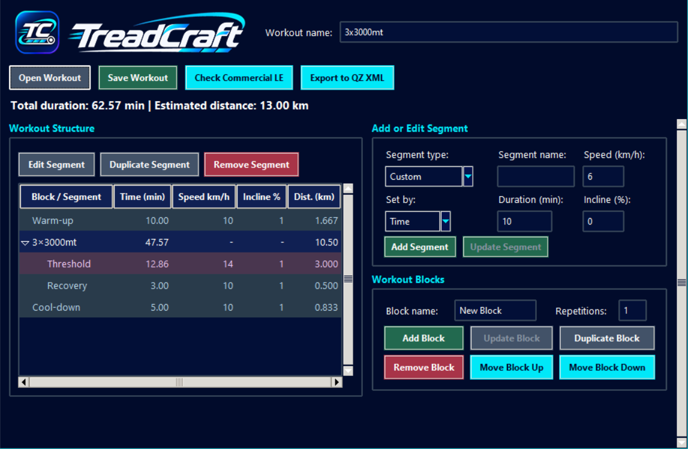

# TreadCraft

## Automatic QZ discovery (development branch)

TreadCraft searches for `_qzws._tcp.local.` for six seconds when the QZ connection
controls first open. **QZ devices** opens the discovered-service list. Select a
service and choose **Connect to selected QZ** to verify its QZ identity using the
existing WebSocket client. Discovery never sends a workout. **Search again**
starts another bounded search; closing the list cancels an active search.
**QZ Devices** and **Send to QZ** occupy the third column of the compact toolbar.
The other columns contain **Open Workout** / **Save Workout** and
**Check Commercial LE** / **Export XML**. The Manual address panel is removed in
this experimental UI; internal endpoint configuration, identity verification and
reconnection remain available to the application. **Cancel** appears only during
cancellable identity verification, not while a workout is being sent.
XML export retains the existing format.

This UI requires a QZ build that advertises the DNS-SD service for device selection.
QZ Android 2.20.29 without discovery can still import exported XML; it cannot be
selected automatically. Keep QZ in the foreground and use the same LAN as Windows;
Internet access is unnecessary. Multicast may be blocked by Wi-Fi client isolation,
VPNs or firewall policy. Multiple advertised local IPv4 addresses are tried only
after the user chooses Connect, with a bounded identity-verification timeout per
address. A verification is a point-in-time check, not a persistent connection.
Refresh after an IP or port change. Sending always requires an explicit action.

Drag a block heading to reorder the whole block, including its repeats and
segments. A line marks the destination. Drop on a different block to place it
before/after that entire block, including when pointing at a child segment.
Press Esc or release outside the list to cancel. Segment drag remains available.
The **Segments** and **Blocks** editors use the same action layout and colours:
Add (green) / Update (neutral) above Remove (red) / Duplicate (neutral).
Select a segment in **Workout Structure** to load its fields automatically, then
choose **Update Segment** to apply edits. There is no separate Edit Segment button.

Use Python 3.12 and install `requirements.txt` in a virtual environment.
DNS-SD uses `zeroconf==0.154.0` and `ifaddr==0.2.0`; no Bonjour executable is required.
On Windows, the existing PyInstaller onedir approach is available as
`python -m PyInstaller --clean TreadCraft.spec`. The spec collects zeroconf's
dynamic modules and dependency/license metadata along with the existing brand
assets. Run tests with `python -m unittest discover -q`. Keep historical pinned
release-build scripts for their original releases; they do not package this
uncommitted development branch.

TreadCraft is a Windows desktop app for building treadmill workouts from individual segments and repeatable blocks. Save workouts as editable JSON, export them as QZ (qdomyos-zwift) XML, or send them directly to QZ Android over local Wi-Fi.



The v0.2.0 redesign adds the TreadCraft branding and a compact layout. The main commands and workout totals stay above the scrollable editor. The window sets its minimum width at startup based on the space needed for the table headings and editor at the current display scaling.

See the [changelog](CHANGELOG.md) and the [draft v0.4.0 release notes](RELEASE_NOTES_v0.4.0.md).

## Run on Windows from the portable ZIP

The portable package is for **Windows x64**. It includes the runtime and requires no installer or Python installation. The v0.4.0 candidate has passed the user's test on a Windows tablet without Python. Publication is pending.

The tested candidate is `TreadCraft-v0.4.0-Windows-x64-cd978aa.zip`, built from commit `cd978aa3a3e6752e16724ad17f6d6a13c0a0c5d5`. Its SHA-256 is:

```text
7dd642467dac7fa0f49bd887890b423f157b0ccc6b45d309235352c23e835da0
```

With QZ Android **2.20.29**, the tablet test passed startup, reconnection after restart, and transfer of the **3 × 3000 m** workout over local Wi-Fi without Internet or a treadmill. QZ received **8 rows** and preserved all **three 3 km repeats**.

1. On the GitHub Releases page, select the **Windows x64 portable ZIP** for the version you want. GitHub's **Source code (zip)** is for the Python launch instructions below. [GitHub Releases](https://github.com/daniel91universe/treadcraft/releases)
2. In File Explorer, right-click the portable ZIP and choose **Extract All**.
3. Open the extracted `TreadCraft` folder and double-click `TreadCraft.exe`. Keep the `_internal` folder beside the executable.
4. To try the app, open `examples\3x3000mt.json` with **Open Workout**. Save your workouts and exports to a folder you can write to, such as Documents.

To verify the download, run `Get-FileHash -Algorithm SHA256 -LiteralPath '<path-to-portable-zip>'` in PowerShell and compare the result with the SHA-256 published alongside the ZIP. The executable is unsigned, so Windows may show a SmartScreen warning. Keep Windows protections enabled and use the archive from the official releases page. [Microsoft SmartScreen guidance](https://support.microsoft.com/en-au/windows/security/windows-security/app-browser-control-in-the-windows-security-app)

## Run on Windows from source

Use Python 3.12 with Tkinter, the configuration tested on Windows. In the Python installer, keep the Tcl/Tk option enabled. Download the repository source as a ZIP and extract it, or clone the repository. Open PowerShell in the folder containing `app.py` and run:

```powershell
py -3.12 -m tkinter
py -3.12 -m pip install -r requirements.txt
py -3.12 app.py
```

The first command opens a Tkinter test window. Close it before continuing. Install the dependencies before going offline if pip needs to download them. If you use `python` instead of the Windows launcher, check that `python --version` reports 3.12 and replace `py -3.12` with `python` throughout this guide.

## Create a workout

1. Enter a **Workout name**.
2. In **Segments**, choose a segment type and give it a name. Set it by **Time** (minutes) or **Distance** (km or m), then enter speed (km/h) and incline (%).
3. Use **Add Segment** to insert at the top level when nothing is selected, or immediately after a selected top-level segment. For repeated intervals, use **Add Block**, then select the block or one of its segments to add each interval or recovery to that block. Click a blank area of the workout list or press **Esc** to clear the selection and return to top-level insertion.
4. To edit a segment, select it under **Workout Structure** to load its fields, change its values, then click **Update Segment**. Drag segments to reorder them.
5. Click **Save Workout** and save the file as `workout.json`. Use **Open Workout** to edit it later.

Try the included [3 × 3000 m workout](examples/3x3000mt.json) with **Open Workout**.

## Send a workout to QZ over Wi-Fi

1. Connect the Windows PC and Android device to the same Wi-Fi network. The transfer was verified with **QZ Android 2.20.29** on a local network without Internet access.
2. Keep a discovery-enabled QZ build in the foreground. Open **QZ Devices**, select the advertised device and choose **Connect to selected QZ**. Wait for **QZ verified.** Selection verifies identity; it does not send a workout. Use **Cancel** to stop verification.
3. Open a workout and click **Send to QZ**. Wait for **Saved in QZ** and check the program in QZ. The included 3 × 3000 m example has **8 rows**, with **3 km** in rows **2, 4, and 6**. Sending saves a program for review.
4. If QZ restarts or changes port, open **QZ Devices** and choose **Search again**, then connect to the current endpoint. There is no manual-address panel in this experimental UI. For QZ versions without discovery, use XML export and file import.

## Export QZ XML

1. Open a workout in TreadCraft with **Open Workout**. To try the export, use [examples/3x3000mt.json](examples/3x3000mt.json).
2. Click **Export XML**. Review the row counts, scheduled duration, estimated duration for distance segments, and compatibility warnings. The example shows 8 rows, including 5 timed and 3 distance segments.
3. Click **Export**, choose a destination for the XML file, and save it. Transfer the file to your Android device and open it in QZ as a training program to review the preview.

The exporter checks a preliminary Commercial LE profile and blocks incompatible workouts, such as segments with negative incline. Saving a new XML file requires a destination that supports hard links. If the destination does not support them, choose another folder.

For command-line use, the XML exporter is also available as a Python module. With `workout.json` in the project folder, run this in PowerShell:

```powershell
py -3.12 -c "import json; from pathlib import Path; from qz_xml_export import export_workout; result = export_workout(json.loads(Path('workout.json').read_bytes())); Path('workout-qz.xml').write_text(result.xml, encoding='utf-8')"
```

To export the example instead, replace `workout.json` in the command with `examples/3x3000mt.json`.

Distance-based segments retain their `distance` in kilometers as the end criterion. The exporter also adds an estimated `duration` for the QZ preview, calculated from the distance and target speed and rounded to the nearest second. For example, a 3 km repeat at 14 km/h has `distance="3"` and `duration="00:12:51"`. If the estimate falls outside QZ's duration range after rounding, the exporter keeps the distance and emits a warning.

The example XML was also opened manually in QZ Android 2.20.29 without a treadmill connected. XML export remains available for transferring the file separately and opening it through the QZ file picker.

Commercial LE compatibility is preliminary. Hardware testing still needs to cover treadmill connection to QZ, actual speed reporting and automatic speed changes, positive incline response and whether decline is supported, time and distance transitions, and pause, resume, and stop. The current profile blocks negative incline.

## Run the tests

```powershell
py -3.12 -B -m unittest
```

Run the command from the project folder. The example and the synthetic legacy fixture are included in the repository.
